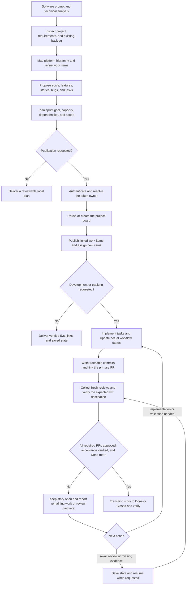

# SCRUM MASTER — Jira & Azure DevOps Agent Skill

[](SKILL.md)
[](references/platforms.md)
[](references/platforms.md)
[](scripts/tracker_api.py)
[](references/git-workflow.md)
[](LICENSE)

**Turn a software prompt and technical analysis into a Scrum backlog, sprint plan, and traceable development workflow in Jira or Azure DevOps.**

SCRUM MASTER is an AI agent skill created for **Nissi Technology**, with installation instructions for **Claude Code, OpenAI Codex, Cursor, GitHub Copilot, and Gemini CLI**. It organizes epics, features, user stories, product backlog items, bugs, tasks, commits, and Pull Requests, keeping story closure dependent on verified PR approval.

**Developed by [@mmrodriguez1987](https://github.com/mmrodriguez1987) · [mrkdev.pro](https://mrkdev.pro).** Built for Nissi Technology and available to the community to use, adapt, and improve under the [MIT License](LICENSE).

[GitHub repository](https://github.com/mmrodriguez1987/nte-skill-scrum-master-by-nissi) · [Workflow](#workflow) · [Features](#features) · [Installation](#installation) · [Configuration](#configuration) · [Usage](#usage) · [Contributing](#contributing) · [License](#license-and-attribution)

## Workflow



The diagram shows the intended workflow, not an always-running service. Tracking occurs while the agent is executing or when work is resumed. Creating a sprint does not start it; merging or deploying still requires the relevant authorization.

## Features

| Capability | What the skill does |
|---|---|
| Prompt-to-backlog planning | Reuses technical analysis and maps requirements to deliverable work |
| Platform-aware hierarchy | Adapts Epic, Feature, Story/PBI, Task/Sub-task, and Bug relationships to actual project types |
| Sprint planning | Proposes a Sprint Goal, capacity-aware scope, dependencies, and explicit assumptions |
| Board provisioning | Reuses a suitable Jira Scrum board or provisions the required board/filter; ensures the appropriate Azure team and boards |
| Token-owner assignment | Resolves the authenticated user and assigns newly created work items when permitted |
| Development tracking | Updates actual workflow states from evidence rather than elapsed time |
| English writing standards | Produces Markdown work items and PRs, with Mermaid diagrams when useful |
| Commit conventions | Uses repository rules or Conventional Commits with neutral work-item references |
| PR approval gate | Requires current approval for every required delivery PR before story closure |
| Resumable synchronization | Saves destination-bound state atomically and reconciles uncertain writes to avoid blind retries |

**One story → one primary PR** is the default. When delivery needs several PRs, all required PRs must have valid approval. Acceptance criteria and the Definition of Done must also be met. Merge is additionally required only when the project's Done policy requires it.

## Installation

### Requirements

- A coding agent with Agent Skills support and permission to read project files and run local helpers.
- Python 3; helper scripts use the standard library and require no third-party Python packages.
- For remote operations: network access and the appropriate Jira, Azure DevOps, and Git permissions.
- For local planning only: no tracker credentials are required.

The locations below follow each agent's documented skill discovery conventions. They describe installation targets, not a claim that every agent/version and remote combination has been integration-tested.

### Prepare the local skill folder

Clone the public repository and enter its root:

```bash
git clone https://github.com/mmrodriguez1987/nte-skill-scrum-master-by-nissi.git
cd nte-skill-scrum-master-by-nissi
```

In the same terminal, define this installation helper. It copies the skill resources without copying private `.env` files, Git history, or Python caches. It expects a new destination; use an intentional update process for an existing installation.

```bash
export SCRUM_SKILL_SOURCE="$PWD"

install_scrum_master() {
  python3 - "$SCRUM_SKILL_SOURCE" "$1" <<'PYINSTALL'
from pathlib import Path
import shutil
import sys

source = Path(sys.argv[1]).resolve()
destination = Path(sys.argv[2]).expanduser().resolve()
files = ["SKILL.md", "reference.md", "README.md", ".env.example", "LICENSE", "AUDIT-2.md"]
folders = ["references", "scripts"]
if not all((source / name).exists() for name in files + folders):
    raise SystemExit("Run setup from the SCRUM MASTER repository root.")
if destination.exists():
    raise SystemExit("Destination already exists; review the existing installation before updating.")
destination.mkdir(parents=True)
for name in files:
    shutil.copy2(source / name, destination / name)
for name in folders:
    shutil.copytree(source / name, destination / name,
                    ignore=shutil.ignore_patterns("__pycache__", "*.pyc"))
print(f"Installed scrum-master at {destination}")
PYINSTALL
}
```

Then choose **one location per agent**. Project commands below run from your target software project's root; the exported source path still points to this skill's downloaded repository. Commands use Bash/Zsh; on Windows, copy the same listed resources to the corresponding location with your shell or file manager.

| Agent | Project installation | Personal installation |
|---|---|---|
| Claude Code | `install_scrum_master "$PWD/.claude/skills/scrum-master"` | `install_scrum_master "$HOME/.claude/skills/scrum-master"` |
| OpenAI Codex | `install_scrum_master "$PWD/.agents/skills/scrum-master"` | `install_scrum_master "$HOME/.agents/skills/scrum-master"` |
| Cursor | `install_scrum_master "$PWD/.cursor/skills/scrum-master"` | `install_scrum_master "$HOME/.cursor/skills/scrum-master"` |
| GitHub Copilot | `install_scrum_master "$PWD/.github/skills/scrum-master"` | `install_scrum_master "$HOME/.copilot/skills/scrum-master"` |
| Gemini CLI | `install_scrum_master "$PWD/.gemini/skills/scrum-master"` | `install_scrum_master "$HOME/.gemini/skills/scrum-master"` |

Keep the installed folder name **`scrum-master`**. Preserve `references/` and `scripts/`; copying only `SKILL.md` leaves the skill incomplete. Shared discovery paths can be visible to multiple agents, so avoid installing duplicate copies unnecessarily.

### Direct Gemini CLI installation

Gemini CLI can install directly from the published repository instead of using the copy helper:

```bash
gemini skills install https://github.com/mmrodriguez1987/nte-skill-scrum-master-by-nissi.git --scope user
```

For a project installation, run the same command from the target project with `--scope workspace` instead. Choose either the managed installation or the manual copy, then confirm discovery with `/skills list`.

Official installation references: [Claude Code](https://code.claude.com/docs/en/skills), [OpenAI Codex](https://learn.chatgpt.com/docs/build-skills), [Cursor](https://cursor.com/help/customization/skills), [GitHub Copilot](https://docs.github.com/en/copilot/how-tos/copilot-on-github/customize-copilot/customize-cloud-agent/add-skills), and [Gemini CLI](https://geminicli.com/docs/cli/skills/).

### Agent invocation

| Agent | How to select the skill |
|---|---|
| Claude Code | Invoke `/scrum-master` with your request |
| OpenAI Codex | Select `scrum-master` from the skill picker or reference `$scrum-master` |
| Cursor | Ask Agent to use the installed `scrum-master` skill |
| GitHub Copilot | Ask the supported agent mode to use `scrum-master` |
| Gemini CLI | Confirm discovery with `/skills list`, then request the Scrum planning workflow |

Restart or reload skill discovery if your agent does not show the installation. Local skill installation does not provision a cloud runtime, upload your local credentials, or register an MCP server.

## Configuration

Use [.env.example](.env.example) to add the relevant variables to the **target software project's** `.env`. Merge into existing configuration rather than overwriting it. Keep the `.env` out of version control; its location is independent of where the skill is installed.

| Service | Authentication |
|---|---|
| Jira Cloud | Email and API token |
| Jira Data Center | PAT |
| Azure DevOps tracking | PAT or Azure DevOps-audience access token, selected by `AZURE_DEVOPS_AUTH_MODE` |
| GitHub / Azure Repos reviews | Separate Git PAT, selected by `GIT_PROVIDER` |

The selected `.env` must exist and is authoritative. Environment-only configuration requires `--use-process-env`. A `.gitignore` prevents new private environment files from being tracked; it does not remove previously committed files. Never paste tokens into chat or place them in command arguments, remote URLs, or commits.

Read-only connection checks:

```bash
python3 <installed-skill>/scripts/tracker_api.py --env-file <project>/.env check
python3 <installed-skill>/scripts/tracker_api.py --env-file <project>/.env --service git check
```

Replace angle-bracket paths before executing. A successful check verifies a read endpoint, not all publication or repository permissions. See [platform configuration](references/platforms.md) and [Git authentication and review evidence](references/git-workflow.md).

## Usage

### Plan from an existing analysis

```text
Use the scrum-master skill with the technical analysis above.
Propose the backlog and next sprint for this project in Azure DevOps.
Break stories into verifiable tasks, reuse existing work, and explain assumptions.
Deliver the plan first without publishing it.
```

### Publish an agreed plan

```text
Publish this agreed plan to the configured Jira project using the project's .env.
Reuse the appropriate Scrum board, or create it if missing.
Assign new work items to the authenticated user and place the selected work
in the agreed sprint. Verify the hierarchy, assignments, and sprint membership.
```

### Develop and track a story

```text
Implement the selected story and keep its tasks and story state current.
Follow repository commit conventions and link the primary Pull Request.
Keep the story open until its required PRs have current approval,
acceptance criteria are verified, and the Definition of Done is met.
```

The skill writes backlog items, commits, PR bodies, and diagram labels in English. Conversational responses can follow your language. It preserves existing assignees unless reassignment is requested and does not treat possession of a token as permission for unrelated changes.

## Story closure and synchronization

- Approval evidence must match an independent story binding: expected API host, repository, PR, project where applicable, and target branch.
- Missing author identities, stale reviews, unrelated PR reviews, incomplete required PR sets, and unknown policy results block closure.
- Automatic closing keywords/options must not bypass the story gate. Preventing other users or external automation from closing stories requires separately configured provider-side enforcement.
- State writes are versioned and atomic, with destination/revision checks and credential-field validation. Successful writes return a summary.
- Remote publication remains single-writer per target. The state-file lock is not a distributed transaction; interrupted writes require reconciliation.

```bash
python3 <installed-skill>/scripts/story_gate.py <project>/.scrum/approval-evidence.json --binding-file <project>/.scrum/story-binding.json
```

See the full [closure evidence contract](references/git-workflow.md) and [execution rules](references/execution.md).

## Documentation and project structure

| Resource | Purpose |
|---|---|
| [SKILL.md](SKILL.md) | Agent entry point, discovery description, and operating rules |
| [reference.md](reference.md) | Backlog decomposition, sprint planning, and state conventions |
| [Writing examples](references/writing-examples.md) | User Story, Bug, Feature, and PR structures in Markdown and Mermaid |
| [Platform reference](references/platforms.md) | Jira and Azure DevOps integration guidance |
| [Execution reference](references/execution.md) | Board provisioning, assignment, states, and closure protection |
| [Git workflow](references/git-workflow.md) | Authentication, commit conventions, and approval evidence |
| [REST helper](scripts/tracker_api.py) | Authenticated API requests and safe diagnostics |
| [Story gate](scripts/story_gate.py) | Local approval-evidence evaluation |
| [State helper](scripts/scrum_state.py) | Atomic synchronization state persistence |
| [Second audit](AUDIT-2.md) | Audit findings and remediation follow-up |

## Validation and limitations

Run the offline test suite from the repository root:

```bash
python3 -m unittest discover -s scripts -p 'test_*.py' -v
```

Tests cover credential handling, pagination, uncertain write outcomes, approval gating, and state persistence. These are local checks; end-to-end board provisioning, identity assignment, policy discovery, and workflow transitions still require validation in a real Jira/Azure project. The REST helper is transport, not an autonomous synchronization daemon.

## Contributing

**The community is welcome to use this skill, report problems, propose improvements, and contribute changes.** Nissi Technology is the original project context; you do not need to be part of Nissi Technology to participate.

1. [Open an issue](https://github.com/mmrodriguez1987/nte-skill-scrum-master-by-nissi/issues) describing the use case, defect, or improvement.
2. Work on a focused branch and follow the English writing and commit conventions.
3. Add regression tests for behavioral changes and run the offline suite.
4. Update the affected instructions/examples and submit a Pull Request explaining the change and its validation.

Useful contribution areas include real-instance integration fixtures, additional Git/tracker adapters, installation portability, clearer examples, and provider-side closure enforcement. Use sanitized fixtures; never contribute tokens, private customer data, or `.env` files. Preserve the attribution and license notices.

## Discoverability

**Skill ID:** `scrum-master`  
**Category:** Agile project management · AI coding agent workflows  
**Integrations:** Jira, Azure Boards, Azure Repos, GitHub  
**Agent installation targets:** Claude Code, OpenAI Codex, Cursor, GitHub Copilot, Gemini CLI

Suggested repository topics: `agent-skills`, `scrum-master`, `scrum`, `agile`, `sprint-planning`, `backlog-management`, `jira`, `azure-devops`, `claude-code`, `codex`, `cursor`, `github-copilot`, `gemini-cli`, `pull-request`, `mermaid`.

The public repository is [mmrodriguez1987/nte-skill-scrum-master-by-nissi](https://github.com/mmrodriguez1987/nte-skill-scrum-master-by-nissi). The README title, summary, headings, and metadata in `SKILL.md` describe the skill for search and catalogs. Marketplace listing and search indexing still depend on each catalog's submission/crawling process; no ranking or indexing time is guaranteed.

## License and attribution

Copyright © 2026 **Nissi Technology**. Developed by **[@mmrodriguez1987](https://github.com/mmrodriguez1987)** — **[mrkdev.pro](https://mrkdev.pro)**.

Released under the [MIT License](LICENSE). You may use, modify, and redistribute the skill, including for commercial work, subject to the license's copyright and permission notice requirements. Community contributions and improvements are welcome.
