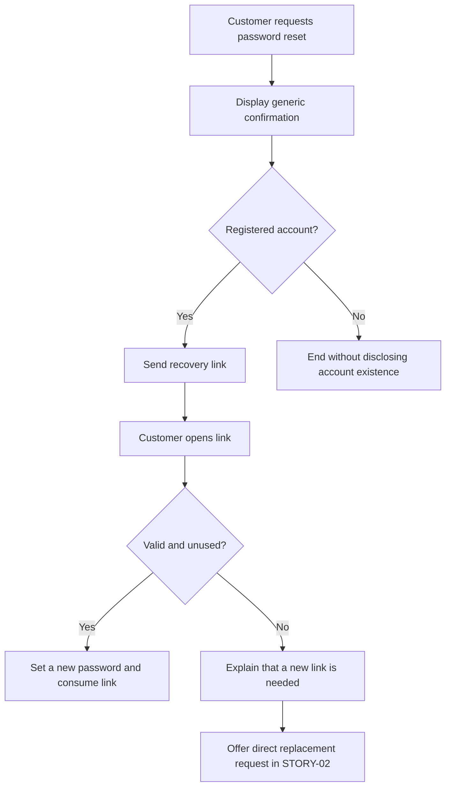

# Writing work items and Pull Requests

Use these examples as writing contracts, adapting their content to the actual project. They illustrate one account recovery feature; names, behavior, relationships, and evidence are illustrative rather than verified project facts.

## Shared conventions

- Write titles, descriptions, acceptance criteria, PR bodies, and diagram labels in English. Preserve API names, identifiers, and quoted source material when translating would change their meaning.
- Use concise, outcome-oriented titles. State the need or defect before implementation details. Avoid prefixes such as `FEATURE:` unless the project requires them.
- Use Markdown headings, lists, checkboxes, tables, code fences, and links as appropriate. Keep the minimum useful structure; do not pad small items with empty sections.
- Retain requirement sources and real parent/dependency links. Local IDs such as `FEATURE-01` and `STORY-01` below are illustrative; replace them with actual local IDs or remote links. Never invent remote issue keys, PR URLs, commits, or test evidence.
- Keep unknown information explicitly pending. An unchecked acceptance checkbox is not a test result. Check it only after verifying the condition. A sample behavior becomes a requirement only when supported by the project's scope or an explicit proposal.
- Follow the repository's PR template when present and incorporate the relevant content below. Do not overwrite unrelated sections in an existing item.
- Before publishing a ready item or PR, replace instructional notes such as “replace with the actual link” with verified content or omit the irrelevant field. Keep legitimate unresolved backlog questions explicitly pending. A draft template is not a completed report.
- Use Mermaid only when relationships, branching behavior, or interactions are clearer as a diagram. Keep labels in English, use stable node IDs, and maintain agreement between the diagram and written requirements.
- A diagram supplements acceptance criteria; it cannot replace them. Use a `mermaid` fenced block in Markdown when supported. For Jira fields requiring Atlassian Document Format or Azure fields requiring HTML, convert the prose to the platform's supported format rather than submitting raw Markdown as if it were rendered. If Mermaid is unsupported, retain the diagram in a linked repository Markdown file and summarize its meaning in the item. Do not claim a diagram rendered without checking.

## User Story

Include the user/need/value, boundaries, observable acceptance criteria, dependencies, and executable tasks when useful. Describe an increment of value rather than an isolated technical layer. Keep acceptance criteria separate from the shared Definition of Done and the PR approval condition.

Example Markdown body:

````markdown
# Recover account access through a password reset link

## User story

As a registered customer who has forgotten my password,
I want to reset it through a link sent to my registered email address,
so that I can regain access to my account.

## Context and scope

Parent: FEATURE-01 — Account recovery.
Source: Account recovery requirement in the approved product brief.

This story covers requesting a reset link and selecting a new password.
Changing the registered email address is outside this story's scope.

## Acceptance criteria

- [ ] Given a registered email address, when a reset is requested, then a reset message is queued and the configured generic confirmation is displayed.
- [ ] Given an unregistered email address, when a reset is requested, then the same generic confirmation is displayed without revealing whether an account exists.
- [ ] Given a valid, unused link, when a password meeting the existing password policy is submitted, then the password changes and the link becomes unusable.
- [ ] Given an expired or previously used link, when it is opened, then the password cannot be changed and the customer can request a new link.

## Dependencies and open questions

- Depends on the project's existing email delivery capability.
- Token lifetime: pending confirmation of the project's configured policy.
- Estimate: not yet validated by the team.

## Implementation tasks

- [ ] Implement reset requests and generic responses; verify registered and unregistered email scenarios.
- [ ] Implement token validation and password updates; verify expiration and single-use behavior.
- [ ] Add the reset form and recovery feedback; verify the supported customer journey.
- [ ] Add automated coverage for the acceptance scenarios and report actual results.

## Completion requirements

- All acceptance criteria are verified.
- The shared Definition of Done is met.
- Every PR required for this story has valid approval covering its current changes.
- PR links and verification evidence are recorded before the story moves to Done/Closed.
````

For published tasks, create separate child items from the checklist when requested and supported by the platform. Keep the checklist and child items consistent without treating duplicated lists as separate work.

## Bug

Include reproducible conditions, expected versus actual behavior, impact, and regression acceptance criteria. Separate observations from suspected causes. If reproduction is not established, say so and retain a hypothesis rather than presenting a confirmed defect.

Example Markdown body for an illustrative reproduced defect:

````markdown
# Reject password reset links after their first successful use

## Summary

A previously used password reset link allows another password change.

## Environment

- Affected environment and build: record the environment and build actually tested.
- Preconditions: a test account and a reset link that has already completed one successful password change.
- Reproduction evidence: attach sanitized results from the actual reproduction.

## Steps to reproduce

1. Request a password reset for the test account.
2. Open the link and successfully set a new password.
3. Open the same link again.
4. Submit a different password that meets the existing password policy.

## Expected behavior

The second attempt is rejected because the link has already been used.
The password remains unchanged by that attempt.

## Actual behavior

The second attempt succeeds and changes the password again.

## Impact and triage

- Impact: a used reset link remains capable of changing account credentials.
- Severity and priority: proposed for security triage; not yet confirmed.
- Suspected cause: not established. Inspect token invalidation without assuming the root cause.
- Related requirement: STORY-01, single-use acceptance criterion.

## Fix acceptance criteria

- [ ] Reusing a successfully consumed link cannot change the password.
- [ ] A first valid use still succeeds.
- [ ] Existing expiration behavior remains covered by regression tests.

## Verification

- Reproduction before the fix: pending actual evidence.
- Regression test and result: pending implementation and execution.
- Fix PR: add the real link when available.
````

Do not copy the example's actual behavior into a real Bug unless observed. Add concurrency or other scenarios only when they are in scope or explicitly proposed.

## Feature

State the capability, intended outcome, boundaries, and child stories. A Feature groups deliverable stories rather than duplicating their detailed acceptance criteria. Record business success measures as proposed until agreed.

Example Markdown body:

````markdown
# Enable customers to recover account access

## Outcome

Customers who forget their password can regain access through a verifiable recovery journey.

## Scope

- Request a password reset using the registered email address.
- Set a new password through a valid recovery link.
- Recover gracefully when a link is expired or already used.

## Out of scope

- Changing the registered email address.
- Recovering accounts through customer support identity verification.

## Story breakdown

| Local ID | Deliverable outcome | Dependency |
|---|---|---|
| STORY-01 | Request a reset and set a new password using a valid single-use link | Existing email delivery |
| STORY-02 | Request a replacement directly from an invalid-link screen | STORY-01 |

STORY-02 adds the direct replacement-request interaction; STORY-01 already handles invalid links and explains how to request another one.

## Recovery flow



## Feature acceptance

- [ ] The scoped recovery journey is demonstrated against the child stories' acceptance criteria.
- [ ] Child stories meet Done and their PR approval requirements.
- [ ] Known limitations and deferred work are documented.

## Dependencies, risks, and success measures

- Dependency: email delivery must be available in the target environment.
- Risk: delivery failures may prevent customers from receiving recovery links.
- Proposed success measure: completion of the recovery journey; baseline and target are pending product agreement.
````

Do not present illustrative IDs as existing issues. If Feature is not a supported hierarchy level, retain the grouping in the agreed representation and link its actual children.

## Pull Request

Lead with the problem and resulting behavior. Include real work item links, material implementation decisions, actual validation, and known limitations. Checkboxes must reflect observed state. PR creation does not imply approval or story completion.

The block below is a draft PR template with validation still pending, not a completed example with observed results. Use a draft PR when implementation or required validation is incomplete and the provider supports it. Use one primary PR per story by default and list any additional required delivery PRs explicitly.

````markdown
# Enforce single-use password reset links

## Problem and behavior

Used password reset links must not allow another password change.
This change is intended to consume the link when the first password update succeeds and reject subsequent attempts.

## Related work

- Story: STORY-01 — replace with the actual work item link.
- Bug: replace with the actual defect link if a reproduced defect is being fixed.
- PR role: primary PR for the story; list other required delivery PRs if the scope needs them.

## Implementation

- Describe the actual token-consumption behavior implemented in this diff.
- Explain any material persistence or concurrency decision after inspecting the code.
- Replace these drafting notes before marking the PR ready for review.

## Validation

| Check | Actual result | Evidence |
|---|---|---|
| First valid use changes the password | Not run | Pending |
| A second use cannot change the password | Not run | Pending |
| Expired links remain rejected | Not run | Pending |

## Risks and rollout

- Compatibility with previously issued links: not yet assessed.
- Migration or deployment requirements: verify against the implementation.

## Readiness and story closure

- [ ] Implementation is complete and the description matches the diff.
- [ ] Required validation has been executed and actual results are recorded.
- [ ] Related work items are linked.
- [ ] Required reviewers have approved the current changes.

The related story remains open until all of its required PRs have valid approval and its acceptance criteria and Definition of Done are met.
````

For a ready PR, replace drafting notes with concrete descriptions and actual test results; omit irrelevant sections. Never mark approval based on this checklist alone: query the provider's actual reviews and policies immediately before transitioning the story, following [execution.md](execution.md).

Add a PR diagram only when it explains a material interaction, migration, or behavior change more clearly than prose. A small fix does not need a diagram just because the Feature contains one.

For commit messages, neutral work-item links, PAT configuration, and provider-specific approval evidence, read [git-workflow.md](git-workflow.md). Do not insert automatic closing keywords into the template to replace the explicit story closure gate.
